# SentinelScan Frontend

A modern, responsive vulnerability scanning platform built with React, TypeScript, and Tailwind CSS.

## 🚀 Features

- **Modern UI**: Clean, professional interface with light theme
- **Responsive Design**: Optimized for desktop and mobile devices
- **Type Safety**: Full TypeScript implementation
- **Fast Development**: Vite-powered build system with HMR
- **Accessibility**: WCAG compliant components

## 📸 Dashboard Preview

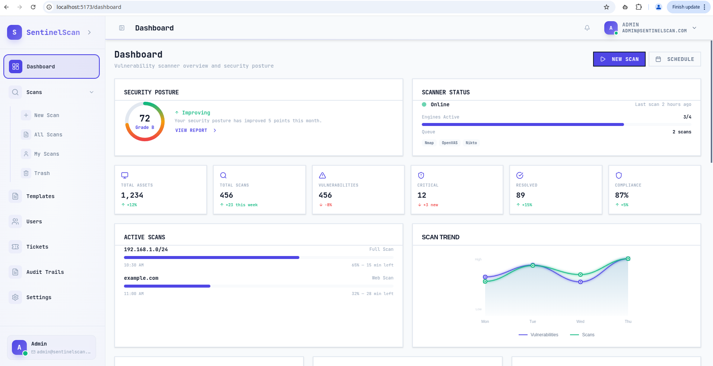
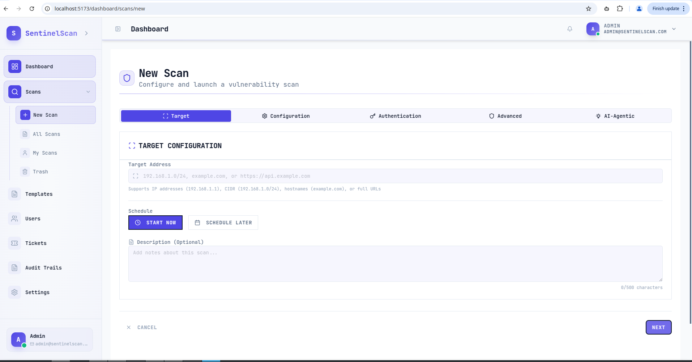
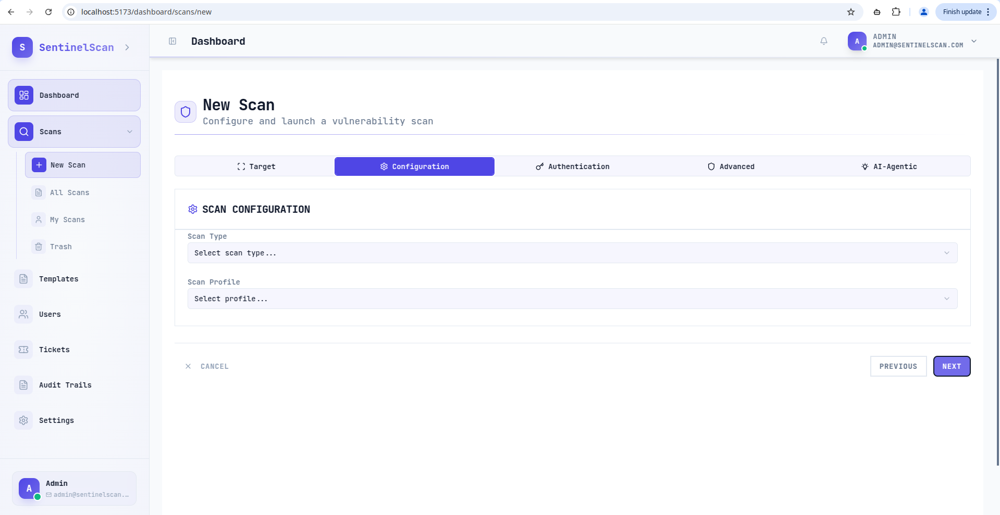
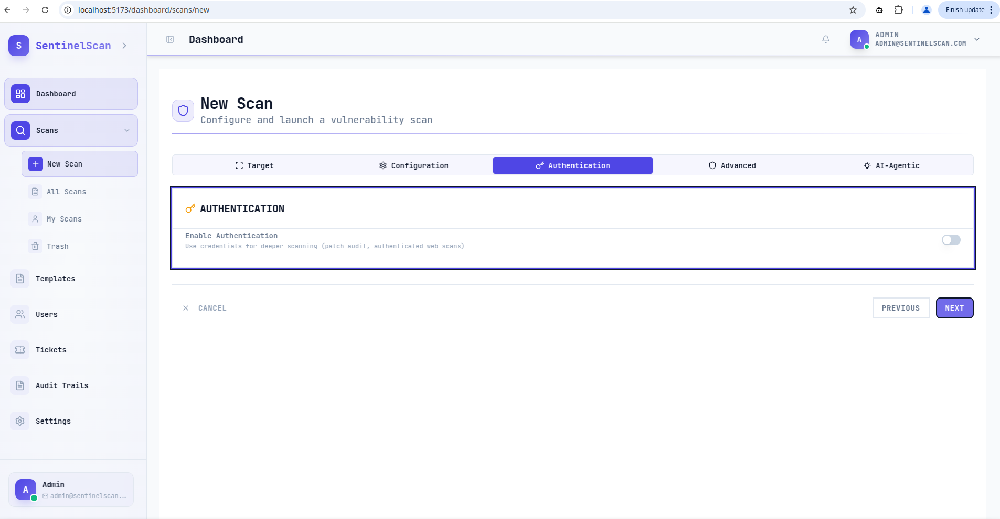
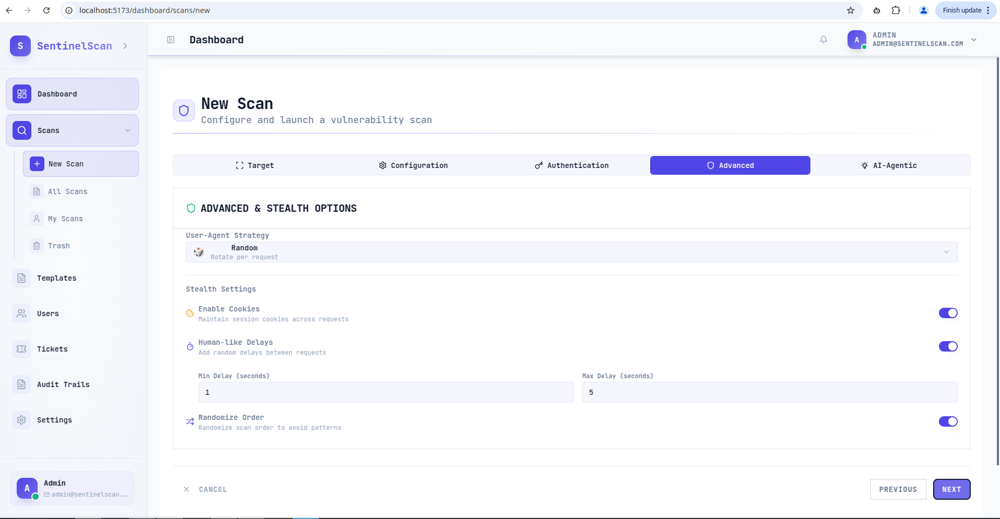
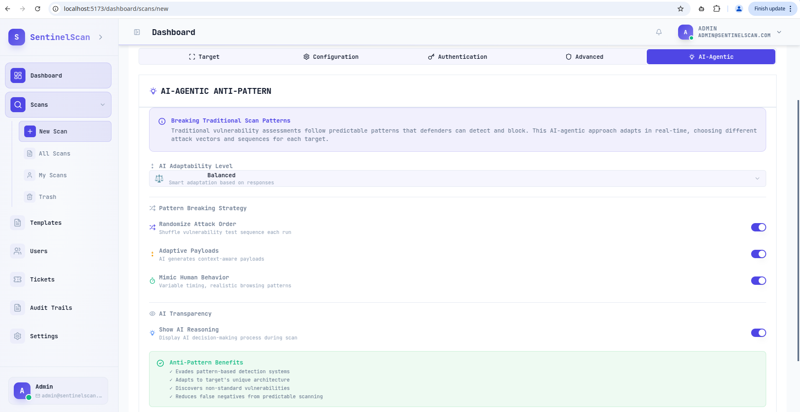
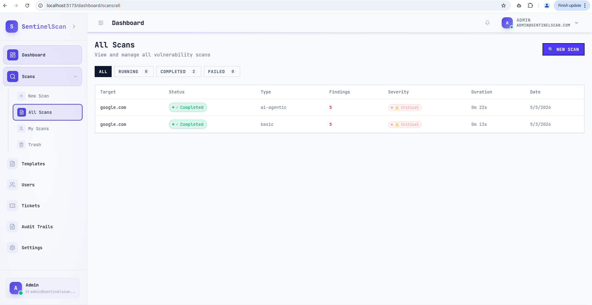
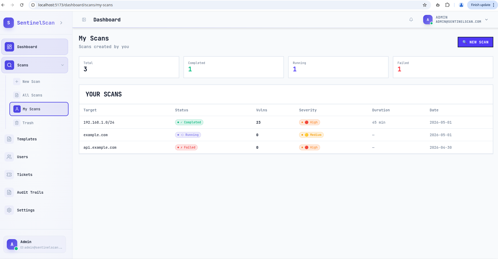
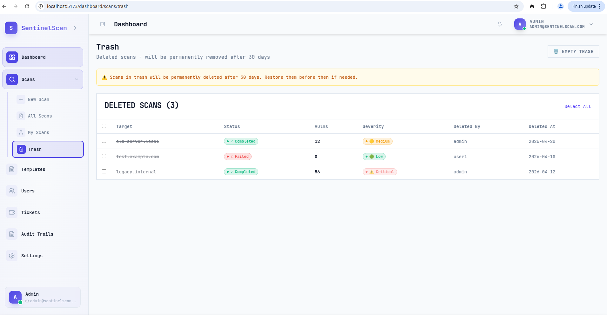
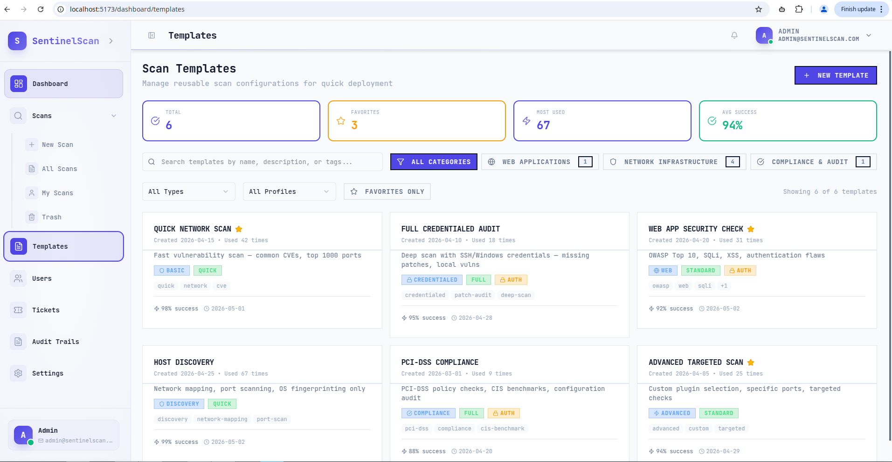
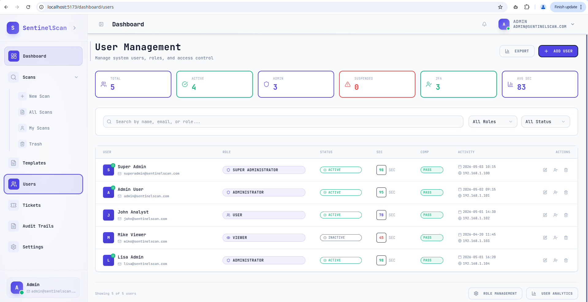
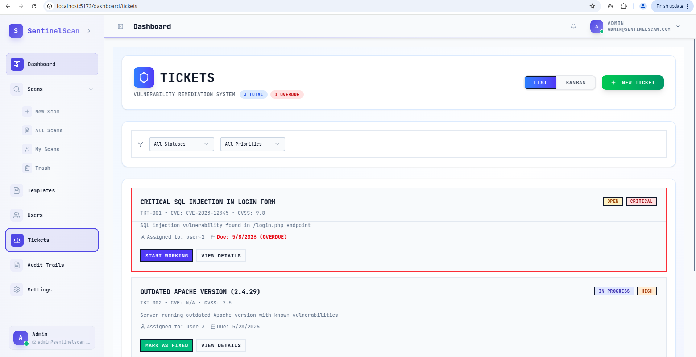
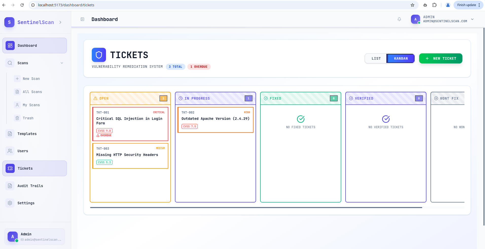
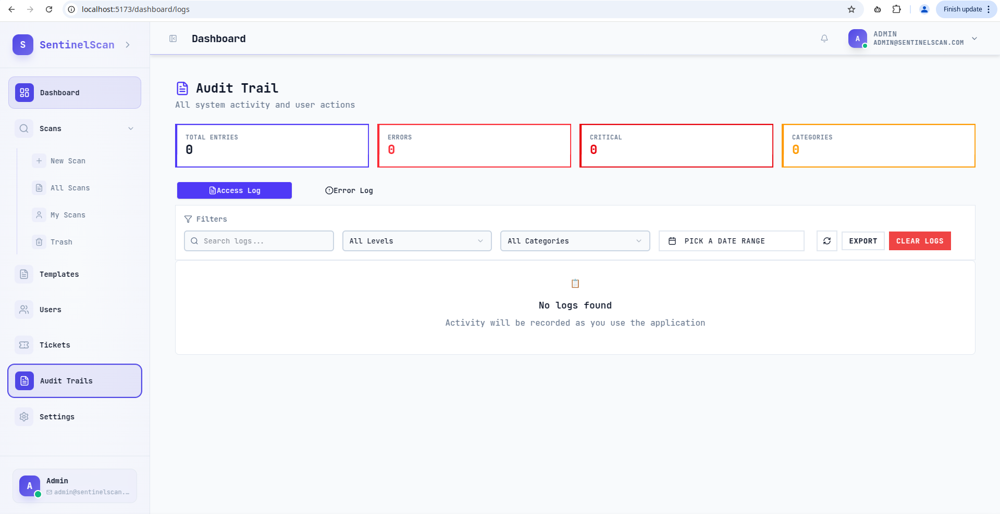
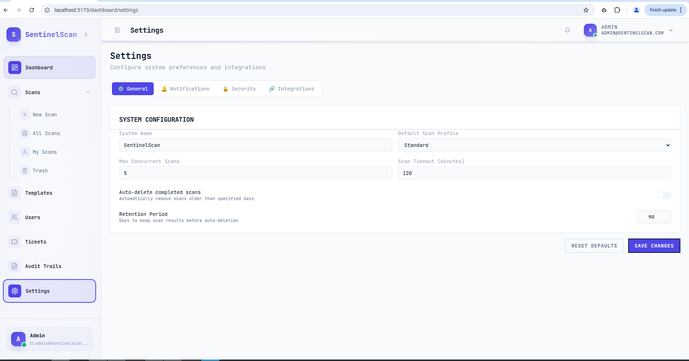
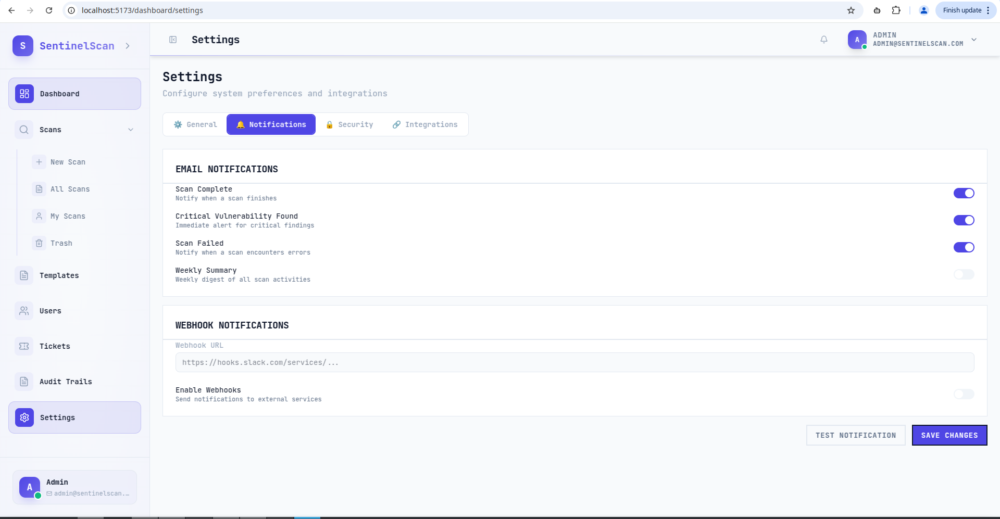
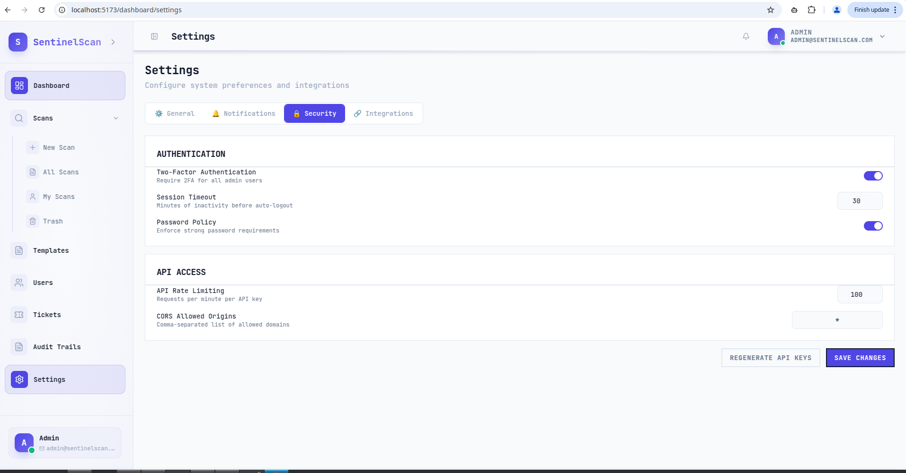
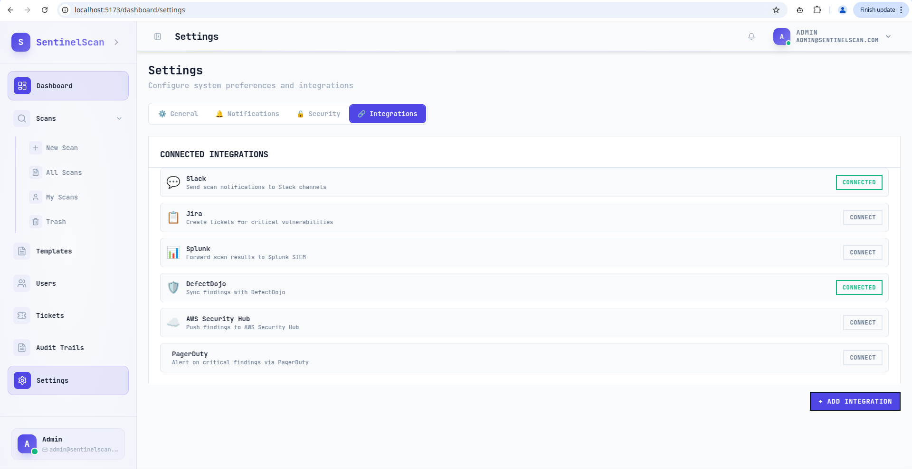
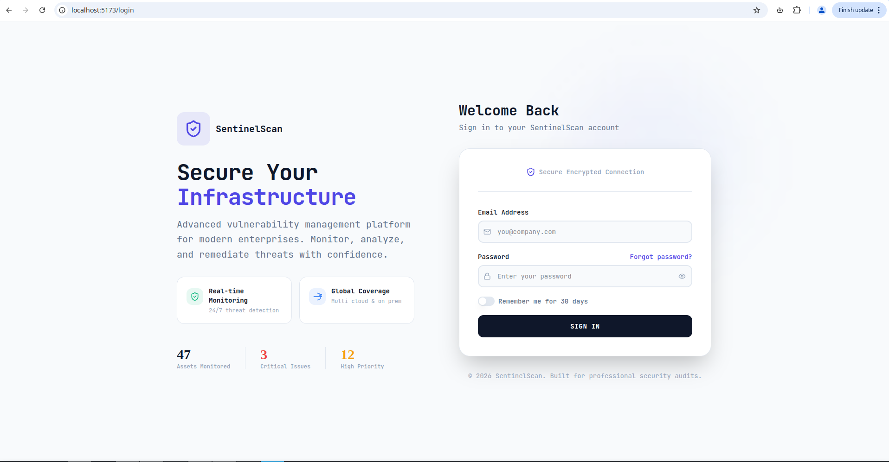

## 🛠️ Tech Stack

- **Framework**: React 18 with TypeScript
- **Build Tool**: Vite
- **Styling**: Tailwind CSS
- **Icons**: Lucide React
- **Routing**: React Router
- **Linting**: ESLint with TypeScript rules

## 🎨 Design System

### Color Palette: Slate & Indigo (Clean Professional)

This palette is the default shadcn/ui (light theme) that's optimized for readability. Perfect for dashboards because it's neutral, doesn't strain the eyes, and the indigo accent gives a technological feel without being overwhelming.

| Token | Color | Usage |
|-------|-------|-------|
| Background | `#ffffff` (white) | Main dashboard background |
| Surface | `#f8fafc` (slate-50) | Cards, sidebar, navbar |
| Border | `#e2e8f0` (slate-200) | Light borders on cards/inputs |
| Text Primary | `#0f172a` (slate-900) | Titles, main text |
| Text Secondary | `#64748b` (slate-500) | Descriptions, labels |
| Primary | `#4f46e5` (indigo-600) | Action buttons, links, focus |
| Primary Hover | `#4338ca` (indigo-700) | Button hover states |
| Success | `#10b981` (emerald-500) | Completed status, low severity |
| Warning | `#f59e0b` (amber-500) | Medium severity, warnings |
| Danger | `#ef4444` (red-500) | Critical severity, errors |

## 📦 Installation

```bash
# Install dependencies
npm install

# Start development server
npm run dev

# Build for production
npm run build

# Preview production build
npm run preview
```

## 🏗️ Project Structure

```
src/
├── components/          # Reusable UI components
├── pages/              # Page components
│   ├── Index/          # Landing page
│   └── Login/          # Authentication page
├── hooks/              # Custom React hooks
├── lib/                # Utility functions
├── types/              # TypeScript type definitions
└── assets/             # Static assets
```

## 🚀 Development

### Available Scripts

- `npm run dev` - Start development server
- `npm run build` - Build for production
- `npm run preview` - Preview production build
- `npm run lint` - Run ESLint

### Environment Setup

1. Clone the repository
2. Install dependencies: `npm install`
3. Start development server: `npm run dev`
4. Open [http://localhost:5173](http://localhost:5173)

## 🎯 Key Components

### Landing Page (`src/pages/Index/`)
- Hero section with call-to-action
- Statistics showcase
- Features grid
- Mascot section (Go Gopher)
- Contact/CTA section

### Login Page (`src/pages/Login/`)
- Modern split-layout design
- Form validation
- Social login options
- Responsive design

## 📱 Responsive Design

The application is fully responsive and optimized for:
- **Desktop**: 1024px and above
- **Tablet**: 768px to 1023px
- **Mobile**: Below 768px

## 🔧 Configuration

### Vite Configuration
Located in `vite.config.ts`:
- Path aliases (`@/` for `src/`)
- React plugin configuration
- Tailwind CSS integration

### TypeScript Configuration
- `tsconfig.app.json` - Application TypeScript config
- `tsconfig.node.json` - Node.js tooling config

### ESLint Configuration
Modern flat config with:
- TypeScript support
- React-specific rules
- Import sorting

## 🚀 Deployment

### Build Process
```bash
npm run build
```

The build artifacts will be stored in the `dist/` directory.

### Environment Variables
Create a `.env` file for environment-specific configuration:

```env
VITE_API_URL=https://api.sentineltscan.com
VITE_APP_NAME=SentinelScan
```

## 🤝 Contributing

1. Fork the repository
2. Create a feature branch
3. Make your changes
4. Run tests and linting
5. Submit a pull request

## 📄 License

This project is licensed under the MIT License.
